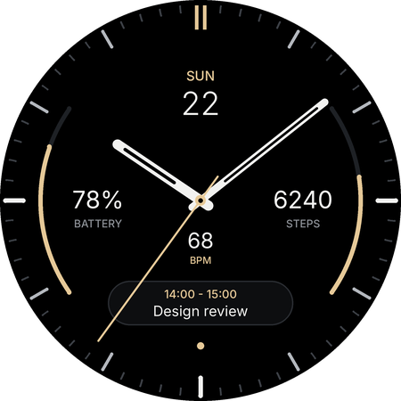
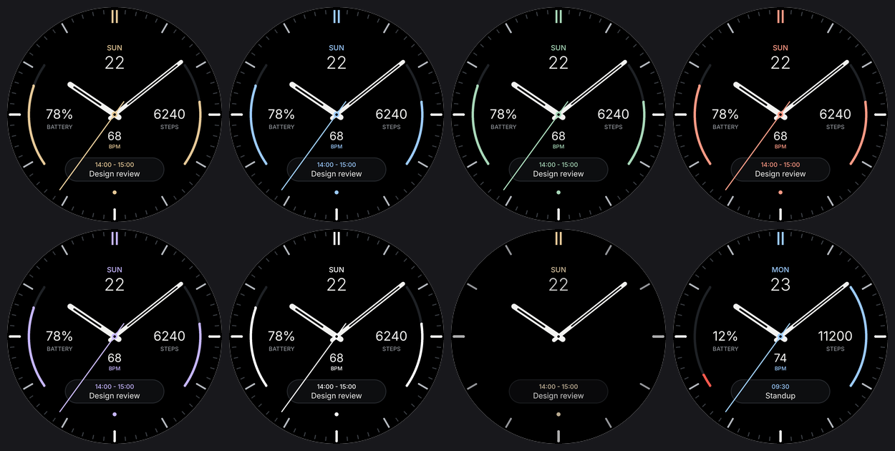

# Meridian — Pixel Watch 用ウォッチフェイス

アナログ針と必要な情報をすっきりまとめた、Pixel Watch（初代 / 2 / 3 / 4）向けのハイブリッド型ウォッチフェイスです。
Google 推奨の **Watch Face Format (WFF) v1** で作っているため、コードを含まず、電池への負担が小さいのが特長です。



## 表示内容

| 位置 | 内容 | 補足 |
|---|---|---|
| 上部 | 曜日・日付 | 端末の言語設定に従って表示 |
| 左 | バッテリー残量（数値とゲージ） | 15% 以下でゲージが赤になり、充電中はラベルが `CHARGING` に変わる |
| 右 | 歩数（数値と目標達成ゲージ） | 歩数目標に対する達成率をゲージで表示 |
| 中央下 | 心拍数 (BPM) | 計測値がないときは `--` を表示 |
| 下部 | 次の予定 | コンプリケーション。初期設定はカレンダーの「次の予定」で、ほかのデータにも変更できる |
| 最下部 | 未読通知 | 未読の通知があるときだけ、テーマカラーの小さな点を表示 |
| 針 | 時針・分針・秒針 | 時針と分針はスケルトン風のスリット入り。秒針はテーマカラー |

## カスタマイズ（ウォッチフェイスを長押し →「カスタマイズ」）

- **テーマカラー**: シャンパン / グレイシャー / セージ / コーラル / ラベンダー / グラファイト
- **秒針**: オン / オフ
- **バッテリー / 歩数ゲージ**: オン / オフ
- **下部の枠**: 次の予定のほか、天気やタイマーなど任意のコンプリケーションを選べます



左から「シャンパン、グレイシャー、セージ、コーラル」「ラベンダー、グラファイト、常時表示（AOD）、低バッテリー時」の順です。

### 常時表示（アンビエント）モード
画面の焼き付きと電池消費を抑えるため、秒針・目盛り・ゲージ・健康データは非表示になり、残りの要素も減光します。

## プロジェクト構成

```
tools/generate.py                       デザインの元データ（XMLとプレビュー画像を生成）
watchface/src/main/res/raw/watchface.xml  ウォッチフェイス本体（自動生成。直接編集しない）
watchface/src/main/res/values*/strings.xml 表示文字列（英語・日本語、自動生成）
watchface/src/main/res/xml/watch_face_info.xml
watchface/src/main/AndroidManifest.xml
.github/workflows/build.yml             CI（公式バリデータでの検証と APK / AAB のビルド）
```

### デザインを変更するとき
`tools/generate.py` の定数（寸法・色・テーマ）を編集してから、次のコマンドを実行します。

```bash
pip install pillow          # プレビュー画像の生成に使う
python3 tools/generate.py   # XML・文字列・プレビュー画像をまとめて再生成
```

## ビルドとインストール

### GitHub Actions を使う（おすすめ）
push するたびに CI が次の処理を行います。

1. `watchface.xml` が生成スクリプトの出力と一致しているか確認する
2. Google 公式の WFF バリデータで XML を検証する
3. デバッグ APK とリリース AAB をビルドし、Artifacts（`meridian-watchface`）として保存する

### ローカルでビルドする
Android Studio（または Android SDK と JDK 17）がある環境で、次のコマンドを実行します。

```bash
./gradlew :watchface:assembleDebug
```

### Pixel Watch にインストールする
1. ウォッチで「設定 → システム → デバイス情報 → バージョン」を開き、「ビルド番号」を 7 回タップして開発者向けオプションを有効にする
2. 「開発者向けオプション → ワイヤレスデバッグ」をオンにする
3. PC から次のコマンドを実行する
   ```bash
   adb pair <IP>:<ペア設定用ポート>     # ウォッチに表示されたコードを入力
   adb connect <IP>:<ポート>
   adb install watchface/build/outputs/apk/debug/watchface-debug.apk
   ```
4. ウォッチフェイスを長押しし、一覧から「Meridian」を選ぶ

## Google Play で公開するとき
- `watchface/build.gradle.kts` の `applicationId` と `namespace` を、自分専用の ID に変更してください
- リリース用の署名鍵を用意し、AAB に署名してください
- 必要に応じて `tools/generate.py` の `PREVIEW_TIME` やプレビュー画像を調整してください

## 動作要件
- Wear OS 4（API 33）以降。Pixel Watch（初代 / 2 / 3 / 4）が対象です
- 初代 Pixel Watch で使う場合は、システムアップデートで Wear OS 4 以降にしてください（「設定 → システム → デバイス情報 → バージョン」で確認できます）
- 心拍数と歩数は、端末の権限設定によっては、初回に許可を求められるか、許可するまで表示されません
